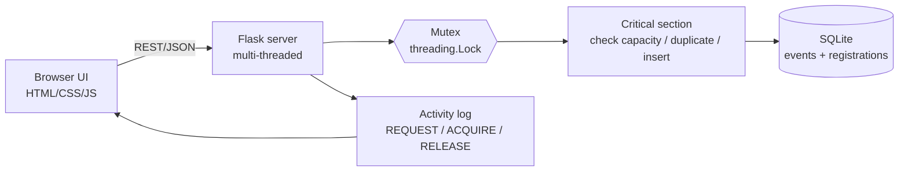
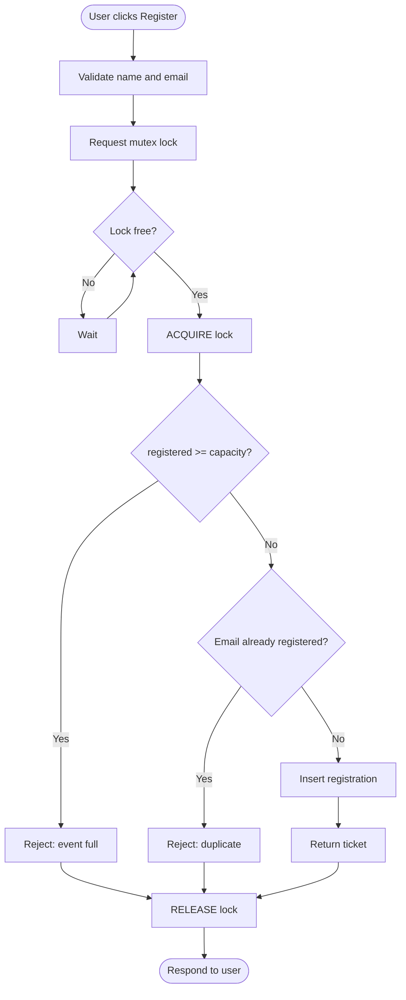

# EventLock – Event / Workshop Registration System
**Product 8 · Mutex / Critical Section · OS & CN (25CAI402PC203)**

> *Several users attempt to register when only one or two places remain. How can the remaining capacity be updated correctly?*
> **Answer:** protect "check capacity → check duplicate → save registration" with one mutex (`threading.Lock`).

## Run it
```bash
pip install -r requirements.txt
python app.py            # open http://127.0.0.1:5000
python tests/test_concurrency.py   # automated race-condition tests
```
Windows: use `py` instead of `python` if needed. Set `PORT=8000` to change the port.

## Features (from the product table)
| Required feature | Where |
|---|---|
| Event list | `GET /api/events`, event cards with capacity bars |
| Registration | `POST /api/events/<id>/register` (mutex protected) |
| Cancellation | `POST /api/registrations/<id>/cancel` (mutex protected, reopens the place) |
| Capacity tracking | live "x / N registered", "Only 1 left!" |
| Duplicate-registration prevention | same email + same event rejected **inside** the critical section |
| Simultaneous-registration test | **Race Lab** – run N threads with and without the mutex |

## Week 1 deliverables
**Problem statement** – Multiple users compete for the final few places of a workshop; concurrent updates can overbook it.

**Requirements** – list events; register with name + email; cancel; show remaining places; never exceed capacity; never register one email twice for the same event.

**Shared data** – the remaining capacity of every event (registrations count vs. `capacity`).

**Synchronization problem** – race condition: P1 and P2 both read "1 place left", both insert → 2 people for 1 place.

**Critical section** – `_critical_section()` in `app.py` (read count → check duplicate → insert). Cancellation also changes capacity, so it takes the lock too.

**Mechanism chosen: Mutex** – the question is *"can two users update this together?"* (not *"how many may use it?"*), so a binary lock fits; a counting semaphore is not needed.

**Block diagram**


**Program flowchart**


**Tools** – Python 3, Flask, `threading.Lock`, SQLite, HTML/CSS/JS, unittest.

**Plan** – W1 planning & design · W2 backend + mutex · W3 UI + cancel/duplicate · W4 Race Lab, integration & tests · W5 demo · W6 evaluation.

## Project layout
```
app.py                    Flask server + mutex + critical section
static/index.html|style.css|app.js   website
tests/test_concurrency.py race-condition tests
```

## Demo script (for viva)
1. Open **Race Lab**, pick *Last Chance: Mutex Masterclass* (capacity 2), 10 users.
2. **Run WITHOUT mutex** → more than 2 registered, red "Race condition detected", log shows `NO-LOCK`.
3. **Clear simulated registrations**, then **Run WITH mutex** → exactly 2 accepted; log shows each user `REQUEST → ACQUIRE → RELEASE` one at a time.
4. Tick *Same user clicks many times* to show duplicate prevention.

## Notes
- The DB deliberately has no `UNIQUE(event_id,email)` so the unsafe demo can show duplicates; the mutex does that job here. In production, keep both.
- One global lock is simplest for teaching; a per-event lock would allow different events to register in parallel.
- A single process is assumed (threads). For multiple server processes you would need a DB-level lock/transaction.
